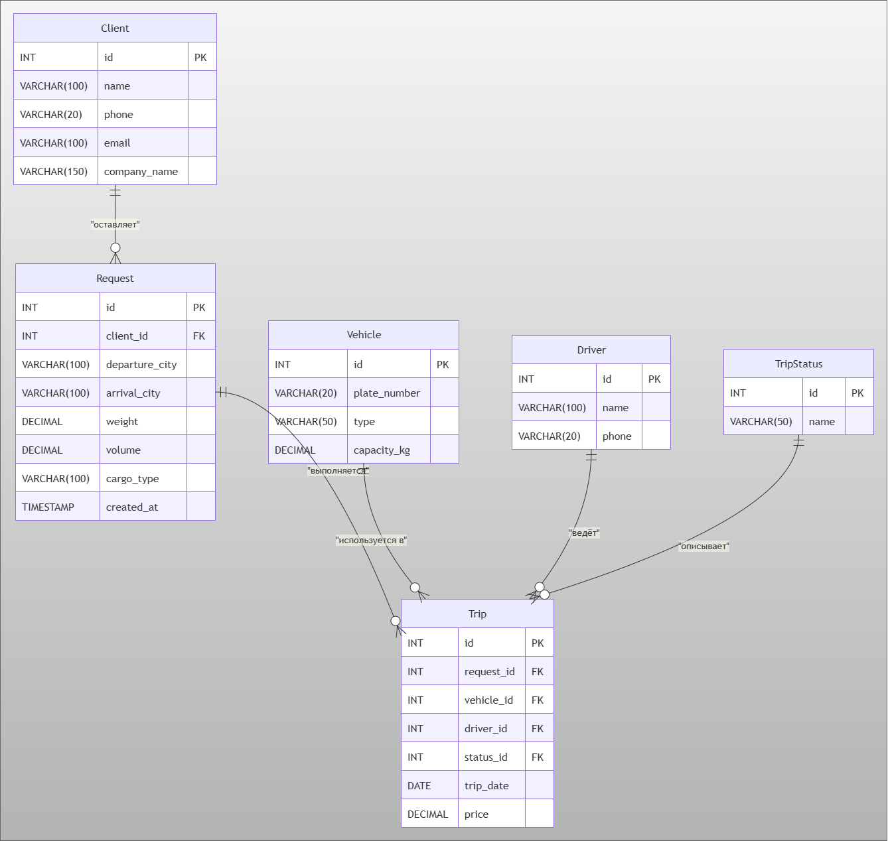

# donavto-db-api

Учебный проект: БД на PostgreSQL, REST API и тесты в Postman для сервиса грузоперевозок.

## Описание задачи

Система хранит клиентов, заказы на перевозку, рейсы, автопарк и водителей. Клиент может посмотреть историю своих рейсов и автопарк, а также связаться с менеджером. Менеджер создаёт заказ и меняет статус рейса.

## Сущности и ER-диаграмма

## Пользовательские требования

(будет добавлено)
